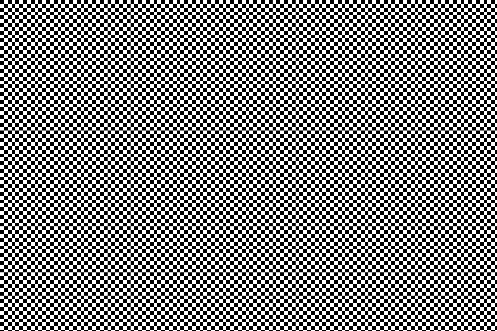

# 引擎内存传输与前台切换

分析固件并观察原厂运行，空闲应用停止入口 `0x10437aa8` 发布标志 1。
空闲应用处理该标志时，经 `0x10438c0a` 转入 `0x10438aea`，随后调用
`0x10635c6c` 清理帧缓冲区。此前该调用未返回，应用管理器保持
当前 `APPIDLE`、目标 `APPLV`、状态 3，实时取景启动入口未执行。

清零请求进入 `0x1038a260`，驱动 `0x102dba60` 使用
`0x20070000` 的两个通道，通道间隔 `0x40`。
完成处理分别为 `0x102db8f6`、`0x102db8b4`，中断号为 103、104。
观察到的清零请求目标为 `0xbec5f200`，行宽和间距为 2880 字节，
共 480 行，合计 1382400 字节。原来的固定启动清零范围不包含该缓冲区，
也没有提供运行时完成中断。

新增 `nikon-z72-memory`，两个引擎各自使用自己的内存视图和中断控制器。
通道内的已支持寄存器如下：

| 偏移 | 实验行为 |
| --- | --- |
| `0x00` | 通道配置读回 |
| `0x04` | 配置读回；位 0、4 门控完成和错误中断 |
| `0x08` | 完成位 0、错误位 4；写一应答 |
| `0x0c` | 只读错误诊断字；细分类型尚未建模，读回零 |
| `0x10` | 写 1 提交，写 0 停止并读回状态 2 |
| `0x14` | 模式 1 填充，模式 0、`0x10` 复制；其他格式尚未支持 |
| `0x18` | 运行时单字节填充值 |
| `0x1c`、`0x20` | 源和目标行间距 |
| `0x24`、`0x28` | 行宽字节数和行数 |
| `0x2c`、`0x30` | 源和目标地址 |

运行时提交采用固定 1000 ns 异步完成，保留行间填充区域。
执行前检查所有行，包括跨越相邻 RAM 区域的跨度；拒绝未映射范围、
外设、只读目标和 32 位地址溢出。单次数据量上限为 256 MiB。
通道 0 未使能中断时保留启动阶段的同步、固定 16 KiB 行间距和
显式清零范围合同，继续支持 `memory-init-error` 故障注入。
两通道复位均取消待完成任务，并清零配置和中断。
精确带宽、其他像素格式和迁移尚未实现。

`tests/test_engine_memory.py` 用合成 ARM 指令检查两个角色的两通道
行填充、复制、间距保护、中断门控与应答、停止状态、跨 RAM 区域、
晚于首行的非法范围及复位取消任务。原有板级启动清零检查也通过。
合成检查已加入 CI 配置，未声称执行远程 CI。

原厂实验使用临时采样参数、空寄存器目标、实验控制器驻留数据和
显式 GPIO 输入，计时为 `shift=0,sleep=off`。新增设备后观察到
`0x1053cfb8` 执行，应用管理器完成切换到 `APPLV`；控制就绪和待更新
位图达到 15，原厂配置完成回调也执行。后续转到 `APPMSG`，图形上传
计数达到 32，画面来源为 `0xbec5f200`，尺寸为 720×480。
图形记录未报告不支持命令或提交失败，但这些计数不能证明画面内容正确。
另一次相同输入的运行已保存并检查 720×480 实际输出：黑底上显示黄色沙漏。
这证明等待界面已输出，尚未显示菜单；采集画面保留在本地运行目录，
没有加入公开源码。
实验输入和应用切换也不能证明正常启动或菜单交互已完成。
后续已追踪沙漏初始化的系统服务状态和卡查询请求，见
[等待界面的服务依赖](message_wait.md)。

验证记录见 [内存传输观察](../../artifacts/engine_memory_validation/report.json)。

## 错误诊断字与从核异常

在带资源存储尾标和初始同步输入的组合运行中，新增的各核故障采样
发现从引擎第二核访问 `0x2007000c`，记录 `DFAR=0x2007000c`、
`DFSR=0x1008`。此前设备把该通道偏移的读写均作为非法访问。
分析固件确认，通道错误处理 `0x102db8f6` 与 `0x102db8b4` 分别读取
`0x2007000c`、`0x2007004c`，提取起始于位 16、20 的两位诊断字段。

设备现允许读取这两个诊断字，继续拒绝写入；尚未建立错误分类，
返回值保持为零，原有错误状态位与失败传输行为不变。
两个角色的合成通道检查和板级访问异常检查均通过。

修复后的原厂组合运行完成菜单键按下和释放，所有四核故障寄存器及
控制器故障状态均为零。系统到达模式 4，实际画面包含拍摄状态图标，
但后续仍出现 `0x3f`，前台保持 `APPLV`，没有观察到菜单应用。
这只能证明本轮输入传输和异常修复，不能证明正常启动或菜单完成。
记录见[资源头与诊断寄存器验证](../../artifacts/resource_header_validation/report.json)。

## 文件字节复制模式

原始跨引擎文件读取使用模式 `0x10` 进行字节复制，源和目标间距、
行宽均按字节计数。设备现支持这一模式，继续拒绝尚未确认的格式。
两种角色、两个通道的间距保护检查覆盖模式 0 与 `0x10`；
新增不支持格式的拒绝检查。原始调用和共享地址关系见
[卡文件服务与复制](card_file_service.md)。

## 搬运元数据观察

可选 QEMU 事件 `z72_memory_transfer` 记录每次完成的引擎身份、通道、
模式、源和目标地址、行宽、行数、两侧跨度及成功状态，不记录缓冲区内容。
失败请求另进入 `guest_errors` 日志；两者均不改变传输的判定或完成状态。
拍摄探针的 `--trace-sd-host` 同时启用该事件，报告保留最新 1024 条
搬运元数据、总计数和截断标记。`z72_sequence_transfer` 另记录
`0x04251000` 四个通道的命令写入、源、目标、长度及控制字；两种事件
共用报告的 1024 条上限。启用跟踪并不意味着所有 DMA 设备都已覆盖。

## 对端帧池的 DMA 地址视图

此前把类别 7 的默认软件范围 `0xc0000000..0xdfffffff` 固定映射到
DMA 总线 `0x20000000..0x3fffffff`，消除了早期复制错误并恢复 JPEG
余数搬运。但这个固定关系没有覆盖原厂运行中重新设置的地址窗口。
[运行时地址表](../../artifacts/capture_raw_peer_address/report.json)中
类别 7 的软件起点已变成 `0xb0000000`，不能把静态默认值当作当前
DMA 来源。[桥接观察](../../artifacts/capture_raw_bridge_address/report.json)
也没有发现可直接解释左侧 RAW 来源的 PCIe ATU；两份观察均在目标
RAW 搬运前停止，不能单独证明搬运时的窗口。

现依据本引擎域 2 的原厂传输重映射表建立 DMA 别名。八项表的目标、
掩码、总线起点页号分别位于 `0x2013d0b0/+0x20/+0x40`，页大小为
4096 字节；`+0x60/+0x80` 的扩展属性尚未恢复。每次客体修改表项时，
更新内存控制器专用地址空间中的对应窗口，目标仍是对端既有 RAM。
复位清除窗口，迁移后依据寄存器重建；CPU 地址空间不增加这些别名。
主输入第二分片与内存控制器共用页号解码规则。

无效掩码、不对齐或互相重叠的窗口不接入 DMA。当前只支持已恢复的
`0x50000000` 及以上对端 RAM 地址族；更低的外设/寄存器窗口仍未支持，
不会把其大量 MMIO 子区域复制到 DMA 视图。实际搬运继续检查每一行的
RAM 属性、32 位边界及只读目标，未映射空洞没有额外存储。

`tests/test_peer_memory.py` 检查两个方向：给两端同号地址写入不同
内容，通过内存控制器从 `0x28108380` 读取 512 字节；再把同一总线
窗口从 C 地址族改为 B 地址族，确认重新读取新来源，同时检查源、
目标保护字、正常状态以及 CPU 寄存器隔离。
新增左侧 RAW 契约使用 `0x0a700000` 总线源、主引擎 `0x62700000`
实际来源和从引擎 `0xbad0a000` 目标，以原厂 `0x1080/0x3090`
步长复制三行，核对右侧分片保护值；另一候选 `0xaa700000` 放入
不同数据，防止默认软件地址恰好读到零而假通过。禁用窗口和未支持
属性均报告错误且不改目标。原有 CPU 对端访问、RAM 空洞和程序上传
检查一起通过；RAW12/RAW14 输入回归也通过。

[整机修复观察](../../artifacts/capture_raw_dynamic_dma/report.json)中，
固件把总线 `0x08000000` 开始的窗口改为对端物理 `0x60000000`，
因此 `0x0a700000` 对应主引擎 `0x62700000`。原来的左分片请求
现在以相同步长和 5520 行正常完成；本次没有内存控制器失败请求。
类别 7 总线 `0x2290cd68/0x2753d840` 则经当前 B 地址族窗口读取，
不再固定落入 C 地址族。

原厂最终保存的 JPG 为 5126646 字节，主图 8256×5504 和三个内嵌
JPEG 均完整解码；四份对应编码器主体均在卡文件中完整匹配。
[内容检查](../../artifacts/capture_raw_dynamic_dma/card_check.json)覆盖
全图 11310 个源棋盘格中心，以及左右分片交界附近的 522 个点，
两组最大 RGB 误差均为零。旧图的 1914 个错误全部位于左侧，见
[修复前检查](../../artifacts/capture_raw_dynamic_dma/before_pattern_check.json)。

本轮观察 413.859 宿主秒、2.698485 计数器秒，诊断调用返回零，
完成回调一次，临时调用体及回调均恢复；七次正常 JPEG 编码、八次
尺寸测量后静照队列为空，四核异常字段均为零。卡中 `NC_FLLST.DAT`
已经包含非零数据；`NIKON001.DSC` 仍为全零，未据此宣称其格式正确。
这些结果验证完整诊断图案的搬运、替代处理和原厂保存链，仍没有恢复
真实场景输入、原厂 DSP 或机身快门的完整原生提交。克隆卡及完整观察
保留在本地忽略目录；下方这张黑白原始 JPG 按用户要求随文档提交。

### 黑白棋盘格的 SD 卡原文件



[下载原始 DSC_0001.JPG](../../artifacts/capture_raw_dynamic_dma/DCIM/100NZ7_2/DSC_0001.JPG)。

使用 7-Zip 从已保留的 SD 卡镜像文件系统提取
`DCIM/100NZ7_2/DSC_0001.JPG`，保留原目录和文件名。
这是原厂封装并写入卡内的完整文件，包含 EXIF 和三个内嵌 JPEG；
未从编码器 RAM 重建文件，未重新编码或修改图片字节。

文件为 8256×5504、5126646 字节；EXIF 厂商、机型和软件为
`NIKON CORPORATION`、`NIKON Z 7_2`、`Ver.01.70`。
完整文件 SHA-256 与卡内原文件的校验记录一致：

```text
a6fe3edf73e2ba574c4d8522d8f1f8c64bc37e6e0269b716f6faefaf70442279
```

图片内容是模拟输入的诊断棋盘格；来源与验证信息见
[卡内容检查](../../artifacts/capture_raw_dynamic_dma/card_check.json)。

## 彩色诊断棋盘格

可用 QEMU 全局属性启用蓝黄测试配色：

```text
-global nikon-z72-boot-config.jpeg-color-checker=on
```

该选项默认关闭。诊断 JPEG 编码器把二值亮度映射为蓝色
`RGB(32,64,224)` 和黄色 `RGB(240,208,32)`，再按原厂量化表生成
JPEG。尺寸测量、正常编码和所有内嵌 JPEG 使用同一配色，因此原厂
质量选择仍依据实际彩色码流的长度。

RAW 分片与中间黑白平面继续承载原有二值测试数据；这是编码时的
诊断配色，不是 Bayer 解码、原厂颜色处理或彩色实时取景。
`tests/test_slave_codec.py` 检查两种配色的解码像素、四种原厂输出尺寸、
缩放测量与实际输出长度一致性，以及原有错误拒绝、容量保护和复位。

[彩色整机观察](../../artifacts/capture_color_checker/report.json)执行
483.641 宿主秒、2.625506 计数器秒，完成回调一次，临时调用体及
回调均恢复，六次正常编码和九次测量后静照队列为空，四核异常字段
及搬运错误均为零。

[卡内容检查](../../artifacts/capture_color_checker/card_check.json)通过，
原有文件保持；从卡原样提取的主图为 8256×5504、7635485 字节。
全图 11310 个棋盘格中心均匹配蓝黄配色，最大 RGB 通道误差为 1；
主图和 160×120、640×424、1620×1080 内嵌 JPEG 均完整解码且有
颜色，四份最终编码器主体在卡文件中完整匹配。图片仅本地保存。
